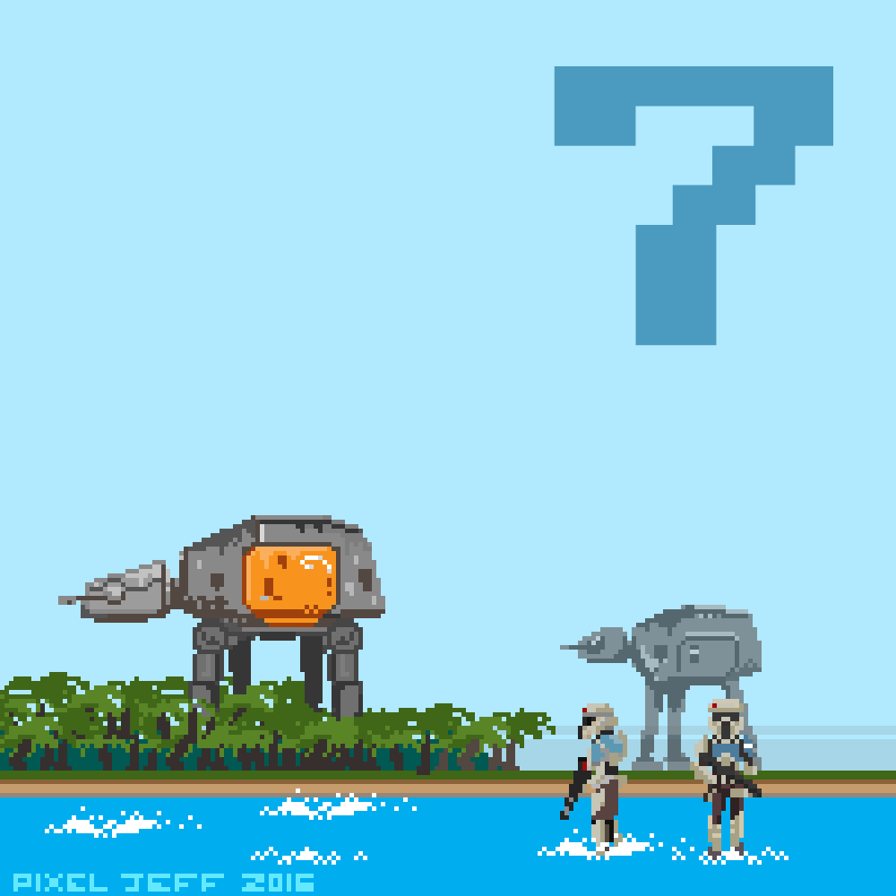

<h1 align="center">✦ trizkix10 ✦</h1>

---

## 🛰️ About me

I'm a 22-year-old from Coquimbo, Chile 🇨🇱, and a **Civil Engineering student specializing in Computing and Informatics** at Universidad Católica del Norte, passionate about learning new technologies and growing my skills every day.

I'm especially drawn to **data science** and everything around **artificial intelligence**: data analysis, databases, APIs and machine learning. I enjoy turning information into decisions and building tools that are useful and well structured.

- 🎮 I build the **user interface** of *Bonkraiders*, a 3D game made in Godot by a student team, working with Git and code reviews between teammates.
- 📐 I teach: I'm a **teaching assistant for Linear Algebra** at my university and I also give **private tutoring** lessons.
- 🔌 I have experience with **C++ and Arduino**, programming microcontrollers for electronics projects.
- 📚 Right now I'm going deeper into **data analysis with Python**.
- 🤝 I value collaboration, adaptability and continuous learning, and I'm always eager to take on challenges that help me grow both academically and personally.
- 🎧 Outside tech, I love listening to music and spending time with my dog **Doki** 🐶.

---

## 🚀 Tech Stack

**Languages**

  
  
  
  
  

**Tools**

  
  
  
  
  

---

## 🌌 Projects

| Project | Description |
|---|---|
| [Bonkraiders](https://github.com/MotelPaso/chipeteao-main) | 3D roguelike made in Godot as a team. I'm in charge of the UI. |
| [Talleres-POO](https://github.com/trizkix10/Talleres-POO) | Object-Oriented Programming workshops in Java. |
| [El-se-or-de-la-noche](https://github.com/trizkix10/El-se-or-de-la-noche) | Web project in HTML. |

---

## 📡 GitHub Stats

  
  

<i>May the force be with you ✨</i>

AT-AT pixel art by <a href="https://www.behance.net/pixeljeff">Pixel Jeff</a>

